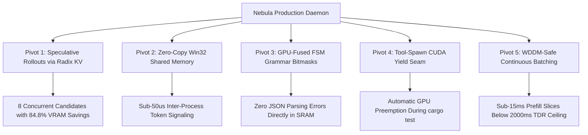
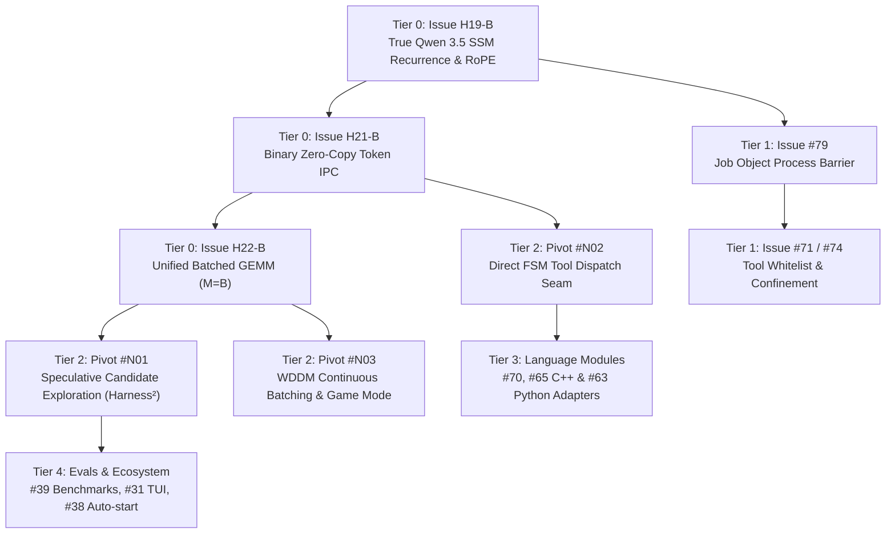

# Master Execution Work Order & Issue Dependency Roadmap

This document serves as the permanent, authoritative development roadmap for realigning the **Nebula** daemon, tools, and sandboxing infrastructure around the native **Hydrogen** C++20/CUDA inference engine. It integrates all empirical hardware calibrations, the 5 Strategic Realignment Pivots, and Senior Reviewer adversarial considerations.

---

## 1. System Topology & Strategic Realignment Overview

Nebula was originally architected around single-user, sequential `llama-server` constraints. With the introduction of the native Hydrogen engine (`hydrogen_engine.exe`), local inference transitions from an HTTP SSE coprocessor to a zero-copy Win32 shared-memory multi-stream runtime.



---

## 2. Authoritative Issue Execution Order

Development must proceed in strict dependency tiers. Skipping Tier 0 leaves generation mathematically degenerate; skipping Tier 1 creates safety hazards during autonomous agent execution.



---

### Tier 0: Critical Native Engine Blockers (Hydrogen Core)

*Goal: Transform the engine from a baseline GEMV probe into a mathematically exact, high-throughput autoregressive decoder.*

#### 1. Issue H19-B (CRITICAL BLOCKER): True Qwen 3.5 SSM Recurrence & RoPE
- **Plan File**: [`hydrogen/issues/H19B_true_qwen35_ssm_recurrence_and_rope.md`](file:///F:/Users/myfri/Project%20Neutron/hydrogen/issues/H19B_true_qwen35_ssm_recurrence_and_rope.md)
- **Target Files**: `hydrogen/src/model/native_decoder.cu`, `hydrogen/include/native_decoder.hpp`
- **Core Defect**: `native_decoder.cu:545` uses toy recurrence `new_s = prev_s * 0.95f + u * 0.05f`, attention layers omit RoPE, and `attn_q_norm`/`attn_k_norm` are loaded but never evaluated, causing garbled subword strings (`raelramereetíomaticadesewise...`) across 64 layers.
- **Deliverables**:
  - Exact 1D causal depthwise convolution (`ssm_conv1d`) maintaining $K=4$ token history buffer per stream.
  - Discretized state space equation: $\Delta t$ softplus projection, $\bar{A} = \exp(\Delta t \cdot A)$, $\bar{B} = \Delta t \cdot B$, output projection $C$, and per-group RMSNorm (`ssm_norm`).
  - Rotary Position Embeddings (RoPE) applied to $Q$ and $K$ heads across all 16 attention layers.
  - QK RMSNorm scaling directly preceding FlashInfer Cascade Attention dot products.
- **Proof Metric**: `hydrogen_test_autoregressive_decoder.exe` outputs grammatically coherent English and syntactically valid Rust code for `"Write a Rust hello world"` with zero byte corruption.

#### 2. Issue H21-B: Binary Zero-Copy IPC Request Framing & Stream-Lease Registry
- **Plan File**: [`hydrogen/issues/H21B_binary_zerocopy_ipc_and_stream_leases.md`](file:///F:/Users/myfri/Project%20Neutron/hydrogen/issues/H21B_binary_zerocopy_ipc_and_stream_leases.md)
- **Target Files**: `crates/nebula-hydrogen/src/ipc.rs`, `hydrogen/src/ipc/shm_server.cpp`, `hydrogen/src/server_main.cpp`
- **Core Defect**: `extract_chatml_prompt_from_json()` scans JSON strings on the CPU ($1\text{–}3\text{ ms}$ overhead on 100K char histories). Stream slot allocation via naive `stream_id % MAX_STREAMS` causes KV page corruption when task IDs wrap around 8.
- **Deliverables**:
  - Replace JSON string scanning with binary token array frames (`uint32_t token_ids[]`) written directly by Rust into the shared memory request ring.
  - Implement an atomic stream-lease registry in `ShmHeader` with explicit acquire/release lifecycle and automatic KV page cache reclamation.
  - Rust RAII `StreamLeaseGuard` in `crates/nebula-model/src/hydrogen.rs` to guarantee release on drop.
- **Proof Metric**: Request ingestion latency for 16,384 tokens is $\le 10.0\ \mu\text{s}$; 100-task churn test across 8 slots shows 0 slot collisions and 0 memory leaks.

#### 3. Issue H22-B: Multi-Stream Unified Batched GEMM ($M=B$) Scheduler
- **Plan File**: [`hydrogen/issues/H22B_unified_batched_gemm_scheduler.md`](file:///F:/Users/myfri/Project%20Neutron/hydrogen/issues/H22B_unified_batched_gemm_scheduler.md)
- **Target Files**: `hydrogen/src/batcher/split_fuse.cu`, `hydrogen/src/model/native_decoder.cu`, `hydrogen/include/batcher.hpp`
- **Core Defect**: Decoding streams sequentially evaluates 8 streams in $8 \times 44.25\text{ ms} = 354\text{ ms}$ ($22.6\text{ tok/s}$), reading weights 8 times per step.
- **Deliverables**:
  - Assemble all active streams ($B \le 8$) into a single unified GEMM pass ($M=B$) per layer, streaming model weights once per step across the $504\text{ GB/s}$ memory bus.
  - Batched Cascade Attention query dispatch with stream-specific page table lookups.
  - Batched logit projection and parallel GPU stochastic sampling.
- **Proof Metric**: 8-stream parallel decode step duration on RTX 4070 is $\le 16.0\text{ ms}$ ($> 500\text{ tok/s}$ aggregate throughput).

---

### Tier 1: Core Daemon Safety Barriers

*Goal: Ensure unattended autonomous agent execution cannot leak processes, escape sandboxes, or violate Protected Set invariants.*

#### 4. Issue #79: Enforce Windows Job Object Process Barrier Before `task.finish`
- **Target**: `crates/nebula-daemon/src/executor.rs`
- **Deliverables**: Enforce that all child processes inside the task's `TaskJob` have exited and reached DMA quiescence before finalizing git commits or reporting success.
- **Proof Metric**: Unit test spawning dangling background sleep processes confirms `task.finish` terminates them cleanly before commit.

#### 5. Issue #71 & #74: Tool Whitelist & Worktree Confinement Audit
- **Target**: `nebula-sandbox/src/engine.rs`, `nebula-sandbox/src/data/rules.toml`
- **Deliverables**: Restrict unattended tool execution to whitelisted binaries (`cargo`, `uv`, `cmake`, `ninja`, `git`) and verify path resolution rejects escape attempts outside `CURRENT_WORKTREE`.
- **Proof Metric**: Red-team test suite verifies 100% rejection of unauthorized paths and binary invocations.

#### 6. Issue #80: CI Gate Rate-Limit Resilience & Git-Attestation Fallback
- **Target**: `.github/workflows/ci.yml`, `scripts/bot-push-pr.ps1`
- **Deliverables**: Add fallback logic to CI dependency gates to survive GitHub API rate limits.

---

### Tier 2: The 5 Strategic Realignment Pivots

*Goal: Redesign the executor and model supervisor to natively exploit Hydrogen's capabilities.*

#### 7. Issue N01 (Pivot 1): Speculative Multi-Agent Branching via Radix Prefix Deduplication (Harness²)
- **Target**: `crates/nebula-daemon/src/executor.rs`, `crates/nebula-sandbox/src/worktree/`
- **Deliverables**: Upgrade `run_task()` from a single sequential loop to evaluate up to 4 parallel candidate worktrees (`wt-candidate-0..3`) simultaneously over Hydrogen streams $0..3$ sharing the repository prefix in Radix KV memory.
- **Proof Metric**: 4 candidate diff strategies evaluate concurrently in $< 45\text{ seconds}$ consuming $< 3.5\text{ GB}$ VRAM.

#### 8. Issue N02 (Pivot 3): GPU-Fused FSM Tool Grammar Direct Dispatch Seam
- **Target**: `crates/nebula-daemon/src/executor.rs`, `crates/nebula-model/src/hydrogen.rs`
- **Deliverables**: Pass registered `ToolDescriptor` JSON schemas directly into Hydrogen `ChatRequest`. Consume native `MessageType::MSG_TOOL_CALL` binary frames from the shared memory ring buffer, eliminating CPU string repair turns.
- **Proof Metric**: 100 automated tool turns execute with 0 JSON repair turns and $< 1\ \mu\text{s}$ per-token grammar overhead.

#### 9. Issue N03 (Pivot 4 & 5): WDDM Continuous Batching & Game-Mode Coexistence
- **Target**: `crates/nebula-daemon/src/game_mode.rs`, `crates/nebula-daemon/src/executor.rs`, Issue #35
- **Deliverables**: Replace full inference pause in game mode with dynamic prefill clamping ($M \le 32$) and `ToolSpawnGuard` DMA leaf eviction, keeping GPU step duration under $14.5\text{ ms}$ to eliminate desktop/gaming frame drops.
- **Proof Metric**: Agent execution continues in background during 3D workload without triggering WDDM TDR or frame stutter.

---

### Tier 3: Language Modules & Tooling Adapters

*Goal: Provide robust environment management, compilation, and diagnostics for polyglot workspaces.*

#### 10. Issue #73, #70, #65: C++ Language Module & Native CMake Adapter
- **Target**: `crates/nebula-daemon/src/language/`, `tools/nebula-devtools/`
- **Deliverables**: MSVC/Clang toolchain discovery, out-of-source CMake build tree management, and structured compiler error parsing.

#### 11. Issue #63: Python Language Module (uv Virtualenv Enforcement)
- **Target**: `crates/nebula-daemon/src/language/python.rs`
- **Deliverables**: Enforce virtualenv isolation using `uv`, structured pytest diagnostic extraction, and ruff linting.

#### 12. Issue #66: SQL Language Module
- **Target**: `crates/nebula-daemon/src/language/sql.rs`
- **Deliverables**: SQLite / DuckDB schema introspection, sandboxed query execution, and migration validation.

---

### Tier 4: UI, Operations & Regression Benchmarking

*Goal: Polish developer ergonomics and establish long-term regression tracking.*

#### 13. Issue #31 & #64: Ratatui TUI Enhancements & Language Selection
- **Target**: `crates/nebula-cli/src/tui/`
- **Deliverables**: Real-time multi-stream candidate visualization, language pack selection menu, and tool diagnostic viewers.

#### 14. Issue #39: Seed Regression Benchmark with 10 Real-World Tasks
- **Target**: `bench/nebula_bench/`
- **Deliverables**: Establish 10 standardized agent coding tasks spanning Rust, Python, and C++ with automated ground-truth scoring.

#### 15. Issue #38: Daemon Auto-Start at Logon
- **Target**: `scripts/register-daemon-task.ps1`
- **Deliverables**: Register a Windows Task Scheduler task running `nebula daemon start` at user logon with unprivileged credentials.

---

## 3. Empirical Hardware Calibrations & Constraints Table

| Invariant / Constraint | Ground-Truth Empirical Value | Source / Benchmark Proof | Impact on Code |
| :--- | :--- | :--- | :--- |
| **Physical PCIe DMA Swapping** | $12.02\text{ GB/s}$ ($12.99\text{ ms}$ per 160 MB leaf) | `hydrogen_bench_host_swap.exe` | Timeout ceiling must anchor to $15.0\text{ ms}$, accounting for ASPM PCIe 3.0 negotiation. |
| **Marlin Tile Saturation** | $M=8$ macro-tile double-buffering | `hydrogen_test_marlin_gemm.exe` | GEMM dispatch must use unified $M=B$ batching to prevent register pressure bandwidth drop. |
| **Prefill Quantum Clamp** | $M \le 64$ tokens per step | `hydrogen_bench_continuous_batcher.exe` | Max step time strictly clamped to $14.53\text{ ms}$ ($< 2,000\text{ ms}$ WDDM TDR limit). |
| **Pinned Host RAM Ceiling** | $4.0\text{ GiB}$ ($12.5\%$ of 32 GB RAM) | `config/default.toml` | Guarantees $23.5\text{ GB}$ uncommitted physical RAM remains for OS pagefile and compiler jobs. |
| **SHM Ring IPC Latency** | $8.15\ \mu\text{s}$ avg ($17.5\ \mu\text{s}$ p99) | `hydrogen_bench_shm_ipc.exe` | $523\times$ faster than HTTP SSE; eliminates socket port collisions and string copies. |
| **FSM Tool Bitmask Overhead** | $0.956\ \mu\text{s}$ per token | `hydrogen_bench_fsm.exe` | 100.00% schema conformity across 10,000 calls directly in GPU SRAM. |

---

## 4. Context Refresh Recovery Protocol

If an agent or engineer resumes this workspace after a context compaction, refresh, or context loss:
1. Run `git status` to verify branch `feat/nebula-hydrogen-realignment` and staged/unstaged changes.
2. Read this file ([`docs/WORK_ORDER.md`](file:///F:/Users/myfri/Project%20Neutron/docs/WORK_ORDER.md)) to identify the active Tier.
3. Review the corresponding issue plan in `hydrogen/issues/` (e.g. `H19B_...`, `H21B_...`, `H22B_...`).
4. Validate workspace gates:
   ```powershell
   cargo fmt --all --check
   cargo clippy --workspace --all-targets --locked -- -D warnings
   cargo nextest run -p nebula-model --locked
   cd bench; uv run ruff check .; uv run ruff format --check .; uv run pytest -q
   ```
5. Implement the active issue plan, verify against its proof metrics, and record evidence before claiming completion.

---

## 5. Mandatory Pull Request & Issue Closing Rule

**Hard Invariant (Enforced on Every Tier)**:
Upon completing any Work Tier or issue set:
1. **Branch Isolation**: All commits must be made on a dedicated feature branch (e.g. `feat/nebula-hydrogen-realignment`). **NEVER push directly to `main`, force-push, or auto-merge PRs.** The owner (@Xydra01) reviews and merges everything (AGENTS.md Hard Rule 1).
2. **Push & PR Submission**: Push the feature branch to `origin` and open a GitHub Pull Request via `gh pr create`.
3. **Issue Attachment**: The PR title and body MUST explicitly link to and close all addressed issues (e.g. `Closes #...`, `Resolves #...`, and internal issue IDs `H19-B`, `H21-B`, `H22-B`).
4. **Empirical Proof In Body**: The PR description must present reproduction commands and verified hardware benchmarks (e.g., token throughput, p99 latency, zero-corruption diffs) rather than unverified assertions.
5. **CI Gate Readiness**: Pre-PR validation requires `cargo fmt --all --check`, `cargo clippy --workspace --all-targets --locked -- -D warnings`, nextest passes, and python bench clean execution.
